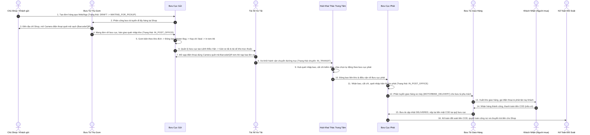

# 01. LUỒNG VẬN HÀNH CHUỖI CUNG ỨNG TOÀN TRÌNH (END-TO-END LOGISTICS WORKFLOW)
## HỆ THỐNG RIKKEI POST WMS LOGISTICS

---

## 📌 1. Bức Tranh Tổng Thể (Big Picture)

Quy trình giao vận của Rikkei Post trải qua **10 chặng vận hành cốt lõi**, kết nối khép kín từ lúc người gửi (Shop/Khách hàng) khởi tạo bưu gửi cho đến khi người nhận cầm hàng trên tay và dòng tiền COD được đối soát chuyển về tài khoản người bán.



---

## 🔄 2. Sơ Đồ Luồng Tác Nghiệp Chi Tiết Từng Chặng (Flowchart)

```mermaid
flowchart TD
    classDef startNode fill:#e0f2fe,stroke:#0284c7,stroke-width:2px;
    classDef stepNode fill:#ffffff,stroke:#64748b,stroke-width:1.5px;
    classDef decisionNode fill:#fef3c7,stroke:#d97706,stroke-width:2px;
    classDef highlightNode fill:#dcfce7,stroke:#16a34a,stroke-width:2px;
    classDef alertNode fill:#fee2e2,stroke:#dc2626,stroke-width:2px;

    Start([Khởi Tạo Bưu Gửi]):::startNode --> Step1[Shop tạo đơn trên Cổng Khách Hàng / API]:::[stepNode]
    Step1 --> Step2[Hệ thống tự động sinh Tracking Code & Barcode Code-128]:::[stepNode]
    Step2 --> Step3[Bưu cục điều phối Bưu tá lấy hàng theo tuyến]:::[stepNode]
    
    Step3 --> Step4[Bưu tá đến Shop: Mở Camera quét mã lấy hàng]:::[highlightNode]
    Step4 --> CheckPickup{Lấy hàng thành công?}:::decisionNode
    CheckPickup -- Không --> Step4Fail[Ghi nhận lý do Shop chưa chuẩn bị hàng / Đổi hẹn]:::[alertNode]
    CheckPickup -- Có --> Step5[Bưu tá mang kiện về Bưu cục gốc]:::[stepNode]

    Step5 --> Step6[Thủ kho Bưu cục quét nhập kho: Đơn trạng thái IN_POST_OFFICE]:::[stepNode]
    Step6 --> Step7[Gom đơn lẻ cùng hướng kho đích -> Đóng bao Master Bag]:::[highlightNode]
    Step7 --> Step8[Bấm kẹp chì an ninh SEAL -> Hệ thống sinh Tem Nhãn A6 chuẩn]:::[highlightNode]
    
    Step8 --> Step9[Quản lý bưu cục lập Lệnh Điều Vận Xe Tải]:::[stepNode]
    Step9 --> Step10[Tài xế nhận lệnh trên Mobile App -> Quét Camera tem A6 nạp bao lên xe]:::[highlightNode]
    Step10 --> Step11[Xe vận chuyển đường trục về Hub trung tâm: IN_TRANSIT]:::[stepNode]
    
    Step11 --> Step12[Hub trung tâm quét mã bao nhập kho Hub]:::[stepNode]
    Step12 --> Step13[Kiểm tra nguyên vẹn Kẹp chì -> Cắt chì, dỡ bao, chia chọn kiện con]:::[stepNode]
    Step13 --> Step14[Gom kiện con chuyển về Bưu cục phát theo tuyến]:::[stepNode]
    
    Step14 --> Step15[Bưu cục phát quét nhập kiện lẻ]:::[stepNode]
    Step15 --> Step16[Phân tuyến giao xe máy MOTORBIKE_DELIVERY cho Shipper]:::[stepNode]
    Step16 --> Step17[Shipper xuất kho đi phát hàng: OUT_FOR_DELIVERY]:::[stepNode]

    Step17 --> CheckDelivery{Khách nhận hàng?}:::decisionNode
    CheckDelivery -- Thành công --> Step18[Thu tiền COD + Khách ký nhận -> DELIVERED]:::[highlightNode]
    CheckDelivery -- Hoãn/Thất bại --> Step19[Chuyển trạng thái DELIVERY_FAILED -> Lưu kho phát lại Lần 2/Lần 3]:::[alertNode]
    
    Step18 --> Step20[Shipper nộp quỹ COD tại Bưu cục phát]:::[stepNode]
    Step20 --> Step21[Kế toán đối soát & Chuyển khoản COD cho Chủ Shop]:::[highlightNode]
    Step21 --> Finish([Hoàn Tất Toàn Trình]):::startNode
```

---

## 📋 3. Chi Tiết Từng Giai Đoạn Vận Hành

### Giai đoạn 1: Tiếp Nhận & Thu Gom Hàng Tại Shop
1. **Khởi tạo đơn hàng**: Shop nhập thông tin người nhận, địa chỉ chi tiết, cân nặng, kích thước, tiền thu hộ COD. Hệ thống tự động phân tích địa chỉ để định tuyến vào Bưu cục phục vụ gần nhất.
2. **Quét mã lấy hàng tại Shop**:
   - Bưu tá mở app trên điện thoại, truy cập tab **"Lấy Hàng"**.
   - Chọn chế độ **"Lấy hàng Shop"**.
   - Bấm **"Quét mã bằng camera"** (hoặc nhập mã tay nếu mã mờ).
   - Hệ thống kiểm tra quyền tác nghiệp, cập nhật trạng thái đơn thành `PICKED_UP`.

### Giai đoạn 2: Nhập Kho Bưu Cục & Đóng Bao Master Bag
1. **Nhập kho Bưu cục gửi**: Khi bưu tá mang hàng về bưu cục, nhân viên khai thác kho sử dụng đầu đọc Barcode quét đơn để xác nhận hàng đã vật lý nằm tại kho (`IN_POST_OFFICE`).
2. **Gom hàng & Đóng bao tải tổng (Master Bagging)**:
   - Thay vì vận chuyển hàng trăm kiện nhỏ dễ thất lạc, nhân viên khai thác gom các kiện có cùng Hub trung chuyển hoặc Bưu cục phát đích đến vào 1 bao tải Master Bag.
   - Khi bao đã đầy, nhân viên bấm **"Đóng bao"** trên hệ thống.
3. **Kẹp chì niêm phong (Security Seal)**:
   - Nhân viên lấy dây kẹp chì nhựa có khắc số serial (ví dụ `SEAL-HN01-8899`), luồn qua miệng bao và bấm chốt.
   - Nhập mã seal vào hệ thống để khóa bao. Lúc này trạng thái bao là `SEALED` (Đã kẹp chì).
4. **In Tem Nhãn A6**:
   - Hệ thống tự động sinh tem nhãn kích thước A6 chuẩn máy in nhiệt (Xprinter/HPRT).
   - Tem thể hiện rõ: Mã bao, Thông tin kho gửi/kho nhận, Số kiện con, Tổng trọng lượng (kg), Số hiệu seal, và đặc biệt là **Barcode Code-128 cùng mã QR-Code khổ lớn** để camera tài xế quét được ngay cả trong điều kiện ánh sáng yếu trong thùng xe tải.

### Giai đoạn 3: Lệnh Điều Vận & Vận Chuyển Đường Trục
1. **Lập lệnh điều vận**:
   - Chỉ **Quản lý bưu cục** nơi xe xuất phát mới có quyền tạo lệnh điều vận.
   - Quản lý chọn tuyến xe tải (`TRUCK_TRANSFER`), chọn xe tải và tài xế trực thuộc bưu cục quản lý.
   - Các tài xế khác trong công ty hoàn toàn không xem được lệnh này.
2. **Cổng tác nghiệp tài xế**:
   - Tài xế được gán mở app điện thoại, truy cập **"Cổng Tác Nghiệp Vận Tải Đường Trục"**.
   - Bấm **"Bắt đầu thực hiện chuyến đi"**.
   - Mở camera điện thoại quét từng mã tem A6 dán trên bao tải. Mỗi lần quét thành công, bao tải được nạp vào danh sách hàng trên xe (`LOADED_ON_TRUCK`).
   - Sau khi xếp đủ hàng, tài xế xác nhận xuất phát. Lệnh điều vận chuyển thành `IN_TRANSIT`.
   - Hệ thống phát sinh sự kiện Kafka `EVENT_DISPATCH_IN_TRANSIT` để các kho đón chuẩn bị cửa dỡ hàng (Docking).

### Giai đoạn 4: Khai Thác Tại Hub Trung Tâm & Bưu Cục Phát
1. **Tiếp nhận tại Hub**:
   - Xe tải đến Hub, nhân viên Hub đối soát mã kẹp chì vật lý với thông tin trên hệ thống.
   - Cắt chì an ninh, quét mã bao tải để xác nhận nhập Hub.
   - Rạch bao, quét từng kiện con ra khỏi bao và đưa vào băng chuyền chia chọn tự động.
2. **Chuyển tiếp về Bưu cục phát**:
   - Các kiện hàng hướng về các quận/huyện được đóng vào bao mới và điều vận đến Bưu cục phát tương ứng.
3. **Nghiệm thu chuyến xe của tài xế**:
   - Tài xế chỉ được phép chuyển trạng thái chuyến đi thành `COMPLETED` khi toàn bộ bao tải trên xe đã được quét nhập kho thành công tại kho đích. Ngăn chặn tuyệt đối việc tài xế bỏ quên bao hàng trên thùng xe.

### Giai đoạn 5: Phân Tuyến Giao Hàng & Phát Tận Tay Khách
1. **Phân tuyến xe máy (MOTORBIKE_DELIVERY)**:
   - Tại bưu cục phát, quản lý bưu cục gán các kiện hàng thuộc khu vực cho Bưu tá phụ trách tuyến đường xe máy tương ứng.
2. **Bưu tá xuất kho đi giao**:
   - Bưu tá nhận hàng, ký nhận xuất kho trên ứng dụng di động (`OUT_FOR_DELIVERY`).
   - Đến địa chỉ người nhận, gọi điện thoại liên hệ giao hàng.
3. **Giao thành công**:
   - Khách nhận hàng, kiểm tra ngoại quan kiện hàng, thanh toán tiền thu hộ COD (nếu có).
   - Bưu tá cập nhật trạng thái `DELIVERED`.
4. **Giao thất bại / Hẹn lại**:
   - Nếu khách không nghe máy, sai địa chỉ hoặc hẹn giao ca khác, bưu tá chọn lý do tương ứng trên app. Kiện hàng chuyển về trạng thái `DELIVERY_FAILED` và được lưu kho bảo quản để phát lại vào ca tiếp theo.

### Giai đoạn 6: Quyết Toán Quỹ COD & Đối Soát Tài Chính
1. **Nộp quỹ cuối ngày**: Bưu tá mang tiền mặt thu hộ COD về bàn giao cho thủ quỹ/kế toán bưu cục.
2. **Đối soát tự động**: Kế toán duyệt bảng kê COD trên hệ thống. Tiền COD được tổng hợp và đối soát theo định kỳ (2-4-6 hàng tuần) và chuyển khoản tự động về ví/tài khoản ngân hàng của Chủ Shop.

---

## 📊 4. Bảng Ánh Xạ Trạng Thái Đơn Hàng (Order State Mapping)

| Mã Trạng Thái | Tên Trạng Thái Hiển Thị | Vị Trí Hiện Vật | Thao Tác Kích Hoạt |
|:---|:---|:---|:---|
| `DRAFT` | Bản nháp | Hệ thống phần mềm | Shop lưu đơn chưa gửi |
| `WAITING_FOR_PICKUP` | Chờ bưu tá lấy hàng | Tại kho Shop | Shop xác nhận gửi hàng |
| `PICKED_UP` | Đã lấy hàng tại Shop | Bưu tá đang cầm | Bưu tá quét mã camera tại Shop |
| `IN_POST_OFFICE` | Đã nhập kho bưu cục | Kho bưu cục gửi / phát | Nhân viên kho quét nhập kho |
| `BAGGED` | Đã đóng bao Master Bag | Trong bao tải đã kẹp chì | Nhân viên quét đóng bao |
| `IN_TRANSIT` | Đang trung chuyển đường trục | Trên thùng xe tải | Tài xế quét camera nạp bao lên xe & xuất bến |
| `AT_HUB` | Đang tại Hub chia chọn | Sàn khai thác Hub | Nhân viên Hub quét nhập bao |
| `OUT_FOR_DELIVERY` | Đang đi giao hàng | Bưu tá giao hàng giữ | Bưu tá quét xuất kho đi giao |
| `DELIVERED` | Giao hàng thành công | Người nhận đã cầm | Bưu tá xác nhận phát thành công |
| `DELIVERY_FAILED` | Giao không thành công | Lưu kho bưu cục phát | Khách từ chối/Hẹn lại |
| `RETURNING` | Đang chuyển hoàn về Shop | Trên đường chuyển hoàn | Quá số lần phát/Khách hủy đơn |
| `RETURNED` | Đã trả hàng về Shop | Shop đã nhận lại | Bưu tá trả hàng và Shop ký nhận |
