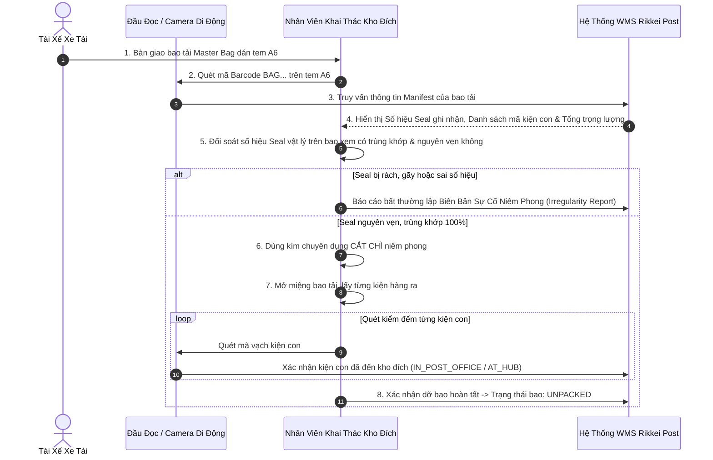

# 02. QUY TRÌNH ĐÓNG BAO MASTER BAG, KẸP CHÌ NIÊM PHONG & IN TEM NHÃN NHIỆT A6
## HỆ THỐNG RIKKEI POST WMS LOGISTICS

---

## 📌 1. Ý Nghĩa & Vai Trò Nghiệp Vụ Của Đóng Bao Master Bag

Trong ngành Logistics bưu chính, việc xử lý hàng chục ngàn bưu kiện nhỏ lẻ tại từng trạm trung chuyển sẽ làm tăng nguy cơ thất lạc, rơi vỡ và kéo dài thời gian bốc dỡ hàng.
**Quy trình Đóng Bao Tổng (Master Bagging)** gom nhiều kiện hàng nhỏ lẻ có cùng hướng vận chuyển vào trong một bao tải lớn duy nhất. Mỗi bao tải được niêm phong bằng một **Kẹp Chì An Ninh (Security Seal)** có mã số định danh duy nhất và được dán **Tem Nhãn Nhiệt Khổ A6** chứa mã vạch Barcode Code-128 và mã QR Code kích thước lớn.

---

## 🔄 2. Sơ Đồ Luồng Tác Nghiệp Đóng Bao & Kẹp Chì (Workflow Diagram)

```mermaid
flowchart TD
    classDef startNode fill:#e0f2fe,stroke:#0284c7,stroke-width:2px;
    classDef stepNode fill:#ffffff,stroke:#64748b,stroke-width:1.5px;
    classDef decisionNode fill:#fef3c7,stroke:#d97706,stroke-width:2px;
    classDef highlightNode fill:#dcfce7,stroke:#16a34a,stroke-width:2px;
    classDef alertNode fill:#fee2e2,stroke:#dc2626,stroke-width:2px;

    Start([Bắt đầu đóng bao]):::startNode --> Step1[Nhân viên kho mở giao diện: Quản Lý Đóng Bao & Kẹp Chì]:::[stepNode]
    
    Step1 --> Step2[Hệ thống hiển thị bộ lọc Kho Đích Đến và Bảng Thống Kê Số Bao]:::[stepNode]
    Step2 --> Rule1{{Quy tắc UI: Chỉ hiển thị số lượng bao của các kho đích có số lượng > 0}}:::decisionNode
    
    Rule1 --> Step3[Bấm 'Tạo Bao Mới' -> Chọn Kho Đi và Kho Đích Đến]:::[stepNode]
    Step3 --> Rule2{{Quy tắc hệ thống: Ban đầu Tài xế = null, Xe tải = null}}:::decisionNode
    
    Rule2 --> Step4[Quét mã Barcode từng kiện hàng cho vào bao tải]:::[highlightNode]
    Step4 --> CheckCapacity{Bao đầy hoặc hết kiện cùng tuyến?}:::decisionNode
    CheckCapacity -- Chưa đủ --> Step4
    CheckCapacity -- Đã đủ --> Step5[Bấm 'Khóa bao' trên giao diện]:::[stepNode]

    Step5 --> Step6[Nhân viên lấy Kẹp Chì nhựa vật lý niêm phong miệng bao]:::[stepNode]
    Step6 --> Step7[Nhập mã Kẹp Chì SEAL vào hệ thống -> Trạng thái: SEALED]:::[highlightNode]
    
    Step7 --> Step8[Bấm 'In Tem Ngay' -> Hệ thống render Tem Nhãn A6 chuẩn nhiệt]:::[highlightNode]
    Step8 --> Step9[Tem A6 in ra gồm: Barcode Code-128 + QRCodeSVG]:::[stepNode]
    Step9 --> Step10[Dán tem A6 lên mặt ngoài bao tải]:::[stepNode]
    
    Step10 --> Step11[Chờ Tài xế xe tải đến nhận hàng theo Lệnh Điều Vận]:::[stepNode]
    
    Step11 --> Step12[Tài xế mở camera điện thoại quét Barcode/QR tem A6 nạp lên xe]:::[highlightNode]
    Step12 --> Rule3{{Lúc này mới tự động gán Tài xế và Xe tải vào Bao Tải}}:::decisionNode
    Rule3 --> Finish([Bao hàng sẵn sàng lăn bánh]):::startNode
```

---

## 📦 3. Quy Tắc Nghiệp Vụ Cốt Lõi (Core Business Rules)

### 3.1. Quy tắc hiển thị thống kê kho đích đến
- Trên thanh Header của trang Quản lý đóng bao, hệ thống hiển thị các thẻ thống kê tóm tắt số lượng bao phân bổ cho từng kho đích đến.
- **Ràng buộc:** Chỉ hiển thị số lượng bao của các kho đích có số lượng bao **lớn hơn 0** (`bag_count > 0`). Các kho không có bao nào gửi đến sẽ tự động ẩn đi để tránh làm rối mắt nhân viên khai thác.

### 3.2. Quy tắc khởi tạo bao tải (Không gán tài xế trước)
- Khi nhân viên kho tạo bao mới, các thông tin:
  - `driver_id` = **NULL**
  - `truck_id` = **NULL**
  - `status` = `SEALED` (khi đã kẹp chì)
- **Tuyệt đối không gán tài xế hoặc xe tải thủ công khi đóng bao**; chỉ khi nào tài xế xe tải thuộc lệnh điều vận đến lấy hàng, mở camera điện thoại quét mã vạch bao tải thì hệ thống mới chính thức gán định danh tài xế và biển số xe tải vào bao tải đó.

### 3.3. Quy cách Tem Nhãn Nhiệt Master Bag Khổ A6 (Standard A6 Thermal Label)
Mẫu tem được chuẩn hóa theo tỷ lệ kích thước A6 (100mm x 150mm), tương thích tuyệt đối với các dòng máy in nhiệt phổ biến (Xprinter XP-420B, HPRT, Shinjuku, Gprinter):

```
+-------------------------------------------------------------+
| RIKKEI POST                     BAG2611268525               |
| SMART EXPRESS LOGISTICS         MÃ BAO TẢI TỔNG             |
|-------------------------------------------------------------|
| TỪ: Bưu Cục The Pride - Hà Đông                             |
| ĐẾN: Trung tâm Khai thác Hub Bắc Hà Nội                     |
|-------------------------------------------------------------|
| Số lượng kiện:                 Tổng trọng lượng:            |
| 1 KIỆN                         0.50 KG                      |
|-------------------------------------------------------------|
| SỐ HIỆU KẸP CHÌ NIÊM PHONG (SEAL):                          |
| SEAL20261126-1531                                           |
|-------------------------------------------------------------|
|                                                             |
|           ||| ||||||| |||||| |||||||| |||| |||              |
|                     * BAG2611268525 *                       |
|                   (Mã Vạch Barcode 128)                     |
|                                                             |
|                         [ QR CODE ]                         |
|                                                             |
|    "Quét mã này khi xuất kho nạp lên xe tải vận chuyển"     |
+-------------------------------------------------------------+
```

- **Mã vạch Code-128:** Render bằng thư viện chuẩn, chiều cao vạch tối thiểu 45px, độ phân giải sắc nét, kèm text human-readable bên dưới.
- **Mã phản hồi nhanh QR-Code:** Render bằng `QRCodeSVG`, kích thước 100x100px với mức sửa lỗi cao (Error Correction Level M), giúp tài xế quét góc nghiêng hoặc dưới ánh sáng yếu của thùng xe vẫn nhận diện được ngay lập tức.

---

## ✂️ 4. Quy Trình Cắt Chì Dỡ Bao & Kiểm Đếm Tại Điểm Đích


