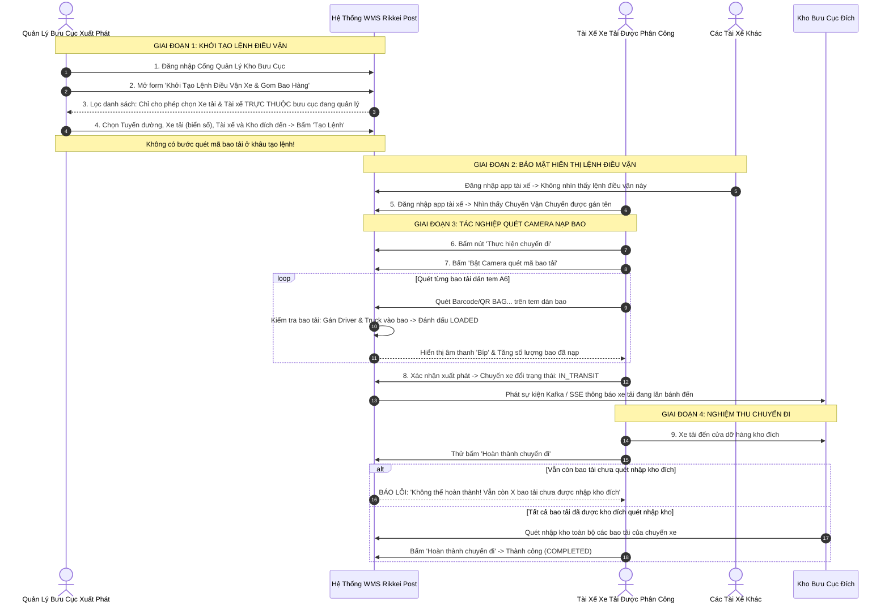
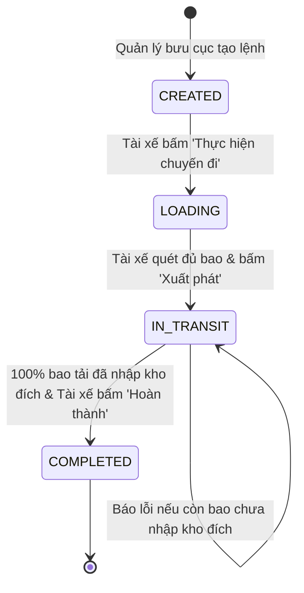

# 03. LỆNH ĐIỀU VẬN & CỔNG TÁC NGHIỆP TÀI XẾ XE TẢI (TRUCK DRIVER DISPATCH)
## HỆ THỐNG RIKKEI POST WMS LOGISTICS

---

## 📌 1. Bối Cảnh Nghiệp Vụ Điều Vận Đường Trục

Hệ thống vận tải đường trục và trung chuyển liên kho (Inter-hub Transfer) là xương sống kết nối mạng lưới bưu chính Rikkei Post. Để đảm bảo tính minh bạch, an ninh hàng hóa và kỷ luật điều hành, hệ thống áp dụng các nguyên tắc điều vận chặt chẽ:
1. **Phân quyền tạo lệnh nghiêm ngặt:** Chỉ Quản lý bưu cục / kho trung chuyển mới được lập lệnh điều vận. Tài xế xe tải KHÔNG được phép tự tạo lệnh.
2. **Quyền hạn kho trực thuộc:** Quản lý bưu cục nào thì chỉ được điều động tài xế và xe tải trực thuộc kho bưu cục đó.
3. **Bảo mật phân công:** Lệnh điều vận chỉ hiển thị đối với tài xế được gán tên đích danh trong lệnh.
4. **Tác nghiệp bằng Camera điện thoại:** Tài xế không nhập tay danh sách bao hàng; toàn bộ thao tác nạp hàng lên xe tải đều được thực hiện thông qua Camera quét mã Barcode/QR trên tem A6 dán ở bao tải.
5. **Điều kiện hoàn thành chuyến đi:** Chuyến xe chỉ được phép chuyển trạng thái `COMPLETED` khi tất cả bao tải trên xe đã được quét nhập kho thành công tại kho đích.

---

## 🔄 2. Sơ Đồ Phân Quyền & Quy Trình Điều Vận (Swimlane Diagram)



---

## 📱 3. Giao Diện & Tính Năng Cổng Tác Nghiệp Tài Xế (Driver Portal)

### 3.1. Chức năng Quét mã bao tải bằng Camera điện thoại
- **Camera trực tiếp trên trình duyệt Web/PWA:** Sử dụng thư viện `Html5Qrcode` cấu hình độ phân giải camera sau (rear facing camera) tối ưu cho việc quét mã vạch 1D và QR 2D.
- **Tốc độ phản hồi:** 
  - Khung quét hình chữ nhật đỏ có đường quét quét laser động.
  - Sau khi quét thành công 1 bao, hệ thống phát âm thanh bíp và hiển thị snackbar thông báo: *"Bao tải BAG2611... đã nạp lên xe tải thành công"*.
  - Khung quét tự động sẵn sàng quét bao tiếp theo mà không cần người dùng phải bấm nút chụp lại.

### 3.2. Cơ chế khóa logic nghiệm thu chuyến xe
Trạng thái chuyến đi trong bảng `dispatch_orders`:
- `CREATED`: Quản lý bưu cục vừa tạo lệnh, chờ tài xế tiếp nhận.
- `LOADING`: Tài xế đã bấm thực hiện, đang mở camera quét nạp các bao tải lên xe.
- `IN_TRANSIT`: Xe đang lăn bánh trên đường thiên lý.
- `COMPLETED`: Chuyến đi kết thúc thành công.



### 3.3. Thuật toán kiểm tra điều kiện hoàn thành (Completion Guard)

```java
// Logic kiểm tra điều kiện hoàn thành chuyến đi tại Backend DispatchOrderService
@Transactional
public DispatchOrder completeDispatchTrip(Long dispatchOrderId, Long driverId) {
    DispatchOrder order = dispatchOrderRepository.findById(dispatchOrderId)
        .orElseThrow(() -> new ResourceNotFoundException("Không tìm thấy lệnh điều vận!"));

    // 1. Kiểm tra quyền tài xế
    if (!order.getDriver().getId().equals(driverId)) {
        throw new AccessDeniedException("Bạn không phải tài xế được phân công cho chuyến xe này!");
    }

    // 2. Kiểm tra danh sách bao tải gán với chuyến xe này
    List<MasterBag> bagsOnTruck = masterBagRepository.findByDispatchOrderId(dispatchOrderId);
    long unReceivedCount = bagsOnTruck.stream()
        .filter(bag -> !BagStatus.RECEIVED_AT_DESTINATION.equals(bag.getStatus()) 
                    && !BagStatus.UNPACKED.equals(bag.getStatus()))
        .count();

    if (unReceivedCount > 0) {
        throw new IllegalStateException("Không thể hoàn tất chuyến đi! Vẫn còn " 
            + unReceivedCount + " bao tải chưa được kho đích quét nhập kho.");
    }

    // 3. Cho phép chuyển trạng thái chuyến đi thành COMPLETED
    order.setStatus(DispatchStatus.COMPLETED);
    order.setCompletedAt(LocalDateTime.now());
    return dispatchOrderRepository.save(order);
}
```
