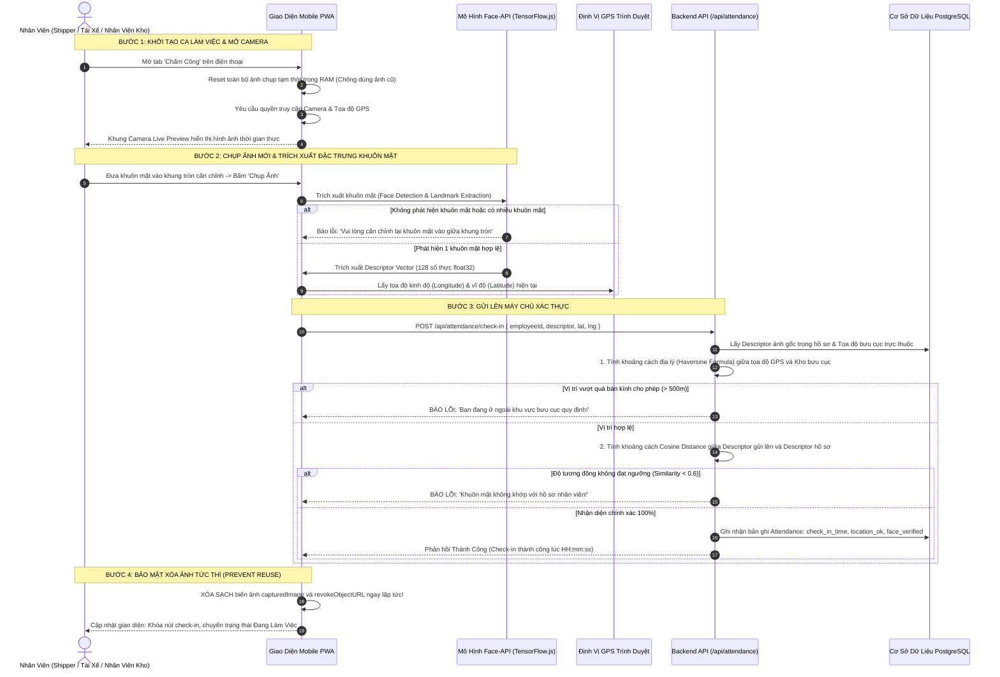

# 04. CHẤM CÔNG SINH TRẮC HỌC FACEID & CƠ CHẾ CHỐNG GIAN LẬN (ANTI-SPOOFING)
## HỆ THỐNG RIKKEI POST WMS LOGISTICS

---

## 📌 1. Mục Tiêu & Thách Thức Nghiệp Vụ Chấm Công Hiện Trường

Hệ thống bưu cục và đội ngũ giao vận của Rikkei Post có hàng ngàn nhân sự phân tán trên khắp cả nước (Bưu tá giao hàng bằng xe máy, Tài xế xe tải đường trục, Nhân viên bốc xếp và khai thác kho).
Các hình thức chấm công truyền thống (thẻ từ, vân tay tĩnh) thường gặp các bất cập lớn:
- Nhân viên kho đeo găng tay hoặc tay dính bụi bẩn khó quét vân tay.
- Bưu tá và tài xế thường xuyên di chuyển ngoài hiện trường, không thể có mặt tại máy chấm công vật lý.
- Tình trạng chấm công hộ bằng ảnh chụp điện thoại của đồng nghiệp hoặc tái sử dụng ảnh chụp cũ lưu sẵn trong máy để check-in gian lận.

**Giải pháp Chấm công FaceID Thông Minh của Rikkei Post** kết hợp mô hình AI trích xuất vector khuôn mặt trực tiếp trên trình duyệt, cơ chế **Live Capture Enforcement (bắt buộc chụp ảnh mới, tự động xóa sạch ảnh cũ)** và ràng buộc bán kính tọa độ GPS của Bưu cục trực thuộc.

---

## 🔄 2. Sơ Đồ Quy Trình Chấm Công FaceID & Chống Gian Lận (Sequence Diagram)



---

## 🛡️ 3. Cơ Chế Chống Gian Lận Tái Sử Dụng Ảnh (Anti-Spoofing & Live Enforcement)

### 3.1. Vấn đề thực tế phát hiện
Ở phiên bản trước, sau khi bấm Check-in hoặc Check-out, biến state `capturedImage` của React vẫn lưu trữ DataURL hoặc Blob của ảnh vừa chụp. Điều này dẫn đến lỗ hổng:
- Người dùng có thể bấm lại nút Chấm công lần nữa mà không cần mở camera chụp lại.
- Thậm chí tải ảnh chân dung chụp từ trước từ thư viện ảnh điện thoại đưa vào.

### 3.2. Giải pháp khắc phục đã triển khai trong mã nguồn
1. **Buộc chụp Live qua `MediaStream`:** Chỉ chấp nhận dữ liệu hình ảnh trực tiếp từ luồng Camera phần cứng (`navigator.mediaDevices.getUserMedia`), không hỗ trợ chọn file từ thư viện ảnh (`<input type="file">` bị vô hiệu hóa).
2. **Cơ chế Tự động hủy ảnh sau thao tác (Immediate Image Discard):**
   ```typescript
   // Mã nguồn xử lý trong AttendancePage.tsx
   const handleCheckIn = async () => {
       try {
           setIsSubmitting(true);
           const result = await apiCheckIn({
               photoBlob: currentSnapshotBlob,
               latitude: currentCoords.latitude,
               longitude: currentCoords.longitude
           });
           toast.success("Chấm công Check-in thành công!");
           
           // AN NINH CỐT LÕI: Xóa ngay lập tức ảnh tạm thời sau khi xử lý
           setCurrentSnapshotBlob(null);
           setCapturedImageUrl("");
           if (videoRef.current && videoRef.current.srcObject) {
               // Dừng stream camera để bảo vệ quyền riêng tư và giải phóng phần cứng
               const tracks = (videoRef.current.srcObject as MediaStream).getTracks();
               tracks.forEach(track => track.stop());
           }
       } catch (error) {
           // Dù thất bại cũng xóa ảnh cũ, bắt buộc người dùng chụp lại
           setCurrentSnapshotBlob(null);
           setCapturedImageUrl("");
           toast.error("Chấm công thất bại: " + error.message);
       } finally {
           setIsSubmitting(false);
       }
   };
   ```

---

## 📱 4. Thiết Kế Giao Diện Mobile Chuẩn Hóa

### 4.1. Tối ưu trải nghiệm màn hình điện thoại
- **Không cuộn ngang (No Horizontal Scroll):** Toàn bộ giao diện được căn chỉnh 100% trong khung hình chiều ngang `max-w-md mx-auto w-full overflow-x-hidden`.
- **Thao tác cuộn dọc mượt mà:** Khung camera tỷ lệ 4:3 nằm gọn ở nửa trên, phần tóm tắt ca làm việc và lịch sử nằm ở nửa dưới.

### 4.2. Bảng Lịch Sử Chấm Công Tinh Gọn Trên Mobile
Do kích thước màn hình điện thoại giới hạn, bảng lịch sử loại bỏ các cột không cần thiết (như ID, Mã máy, Tọa độ GPS chi tiết) và chỉ hiển thị 4 trường thông tin quan trọng nhất:

| Ngày Làm | Thời Gian Check-in | Thời Gian Check-out | Trạng Thái |
|:---:|:---:|:---:|:---:|
| 26/11/2026 | 08:02:15 | 17:31:04 | ✅ Đúng giờ |
| 25/11/2026 | 08:14:22 | 17:30:10 | ⚠️ Đi muộn |
| 24/11/2026 | 07:58:40 | 17:45:00 | ✅ Đúng giờ |

Thẻ trạng thái được định dạng màu sắc trực quan:
- Xanh lục: Đúng giờ.
- Vàng cam: Đi muộn / Về sớm.
- Đỏ: Vắng mặt / Chưa checkout.
