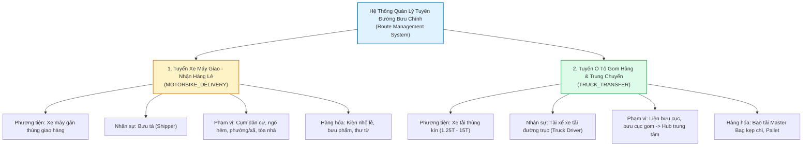
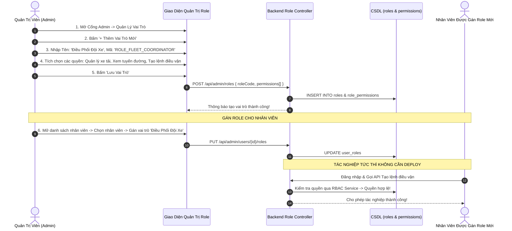

# 06. QUẢN LÝ TUYẾN ĐƯỜNG VẬN CHUYỂN & PHÂN QUYỀN VAI TRÒ ĐỘNG (ROLES & ROUTES)
## HỆ THỐNG RIKKEI POST WMS LOGISTICS

---

## 📌 1. Phân Định Chuyên Biệt Tuyến Đường Giao Nhận

Trong mạng lưới bưu chính của Rikkei Post, mô hình giao nhận được tách bạch thành **2 loại tuyến đường chuyên biệt** tương ứng với 2 phương tiện và 2 loại hình nhân sự hoàn toàn khác nhau:

---

## 🔒 2. Quy Tắc Phân Quyền Quản Lý Tuyến Đường Theo Bưu Cục

### 2.1. Giới hạn tầm nhìn (Visibility Scope)
- **Quản lý Bưu cục nào thì chỉ xem và thao tác trên các tuyến đường thuộc bưu cục mình:**
  - Khi Quản lý Bưu cục đăng nhập vào màn hình Tuyến Đường, danh sách hiển thị tự động được lọc theo `post_office_id` của tài khoản đăng nhập.
  - Quản lý không nhìn thấy và không thể can thiệp vào các tuyến đường thuộc về bưu cục khác trong hệ thống.
- **Tự động điền bưu cục quản lý khi tạo tuyến:**
  - Trong biểu mẫu `+ Thêm Tuyến Đường Mới`, trường **"Bưu cục quản lý"** được khóa và tự động gán giá trị mặc định là bưu cục mà tài khoản Quản lý đang trực thuộc. Tránh sai sót người dùng chọn nhầm bưu cục của đơn vị bạn.

### 2.2. Phân công nhân sự theo tuyến
- Đối với tuyến `MOTORBIKE_DELIVERY`: Hệ thống chỉ cho phép chọn Bưu tá (Shipper) thuộc danh sách nhân viên của bưu cục phụ trách.
- Đối với tuyến `TRUCK_TRANSFER`: Hệ thống chỉ cho phép chọn Xe tải và Tài xế xe tải (`TRUCK_DRIVER`) trực thuộc bưu cục quản lý.

---

## 👥 3. Quản Trị Vai Trò Động (Dynamic Role Management)

### 3.1. Vấn đề thực tế của giải pháp Hardcoded Role
Trước đây, các hệ thống thường định nghĩa danh sách vai trò cứng (Enum hardcoded trong Java hoặc Database seed tĩnh). Khi doanh nghiệp mở rộng quy mô cần thêm vai trò mới (ví dụ: *Điều Phối Viên Đội Xe*, *Nhân Viên Kiểm Định Chất Lượng*, *Thanh Tra An Ninh Hàng Hóa*), lập trình viên phải sửa code backend, sửa giao diện frontend và deploy lại toàn bộ hệ thống rất rủi ro.

### 3.2. Cơ chế Dynamic Role trong Rikkei Post Admin Portal
Hệ thống bổ sung module **Quản Lý Vai Trò Động (Dynamic Role Management)** dành riêng cho Quản trị viên cấp cao (Admin):
1. **Tạo vai trò mới trực tiếp trên giao diện Admin:**
   - Mã vai trò (Role Code): Tự động chuẩn hóa viết hoa không dấu, tiền tố `ROLE_` (ví dụ: `ROLE_FLEET_COORDINATOR`).
   - Tên hiển thị (Display Name): Tiếng Việt rõ nghĩa (ví dụ: *Điều phối viên đội xe trung chuyển*).
   - Mô tả phạm vi trách nhiệm (Description).
2. **Cấu hình nhóm quyền (Permission Checklist):**
   - Danh sách quyền hạn được phân cấp theo nhóm tài nguyên:
     - Nhóm Quản trị hệ thống (Xem người dùng, Thêm người dùng, Đổi mật khẩu).
     - Nhóm Vận hành bưu cục (Đóng bao tải, Kẹp chì, Quét nhập kho, Chia chọn).
     - Nhóm Vận tải đường trục (Tạo lệnh điều vận, Quét camera nạp bao, Cập nhật lộ trình).
     - Nhóm Vật tư & Thiết bị (Quản lý kho vật tư, Lập phiếu xuất, Thu hồi máy hỏng).
     - Nhóm Tài chính & Đối soát (Duyệt COD, Đối soát công nợ shop).
3. **Hiệu lực tức thì (Realtime Dynamic Authorization):**
   - Khi Admin thêm hoặc chỉnh sửa quyền hạn của Role, danh sách quyền hạn được lưu vào bảng `roles` và `role_permissions`.
   - Các API kiểm tra quyền qua Spring Security sử dụng cơ chế kiểm tra động (`@PreAuthorize("@rbacService.hasPermission(authentication, 'PERMISSION_NAME')")`) mà không cần restart server hay sửa lại mã nguồn.

