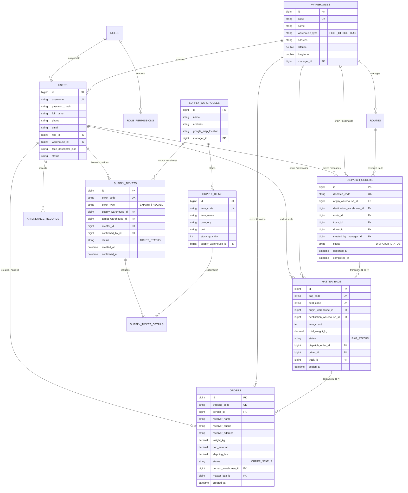
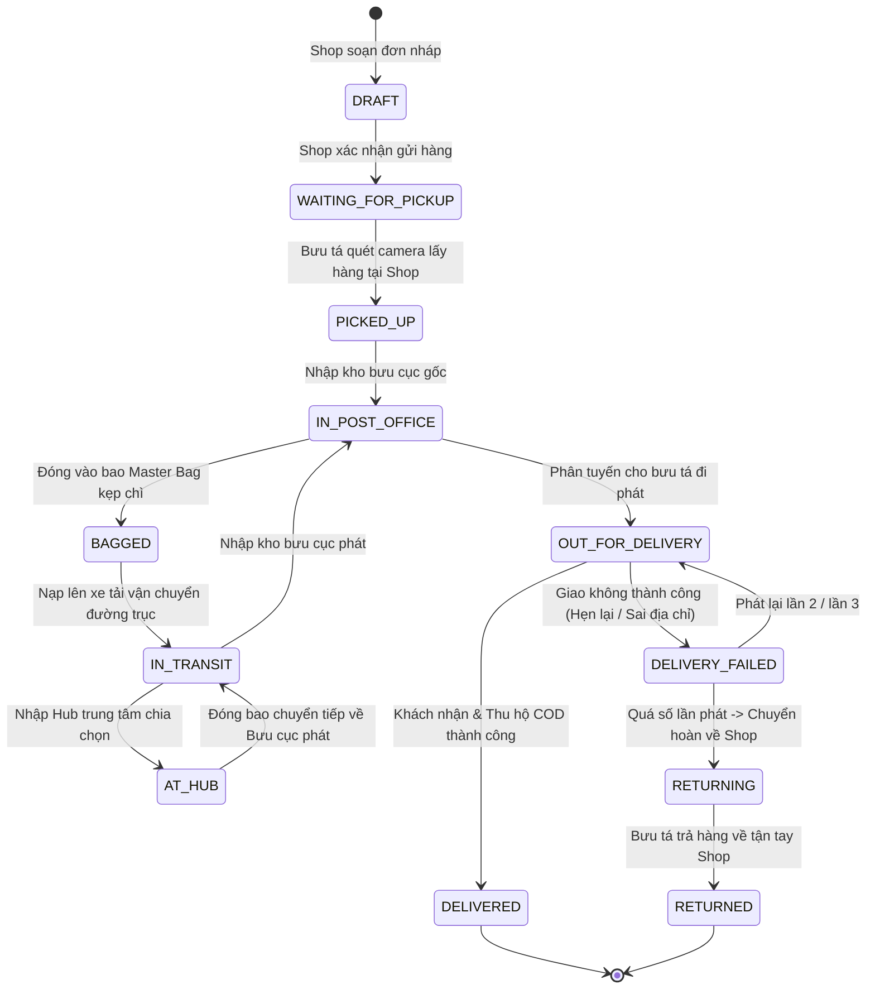
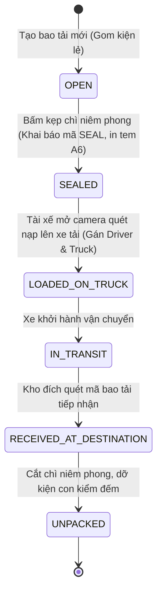
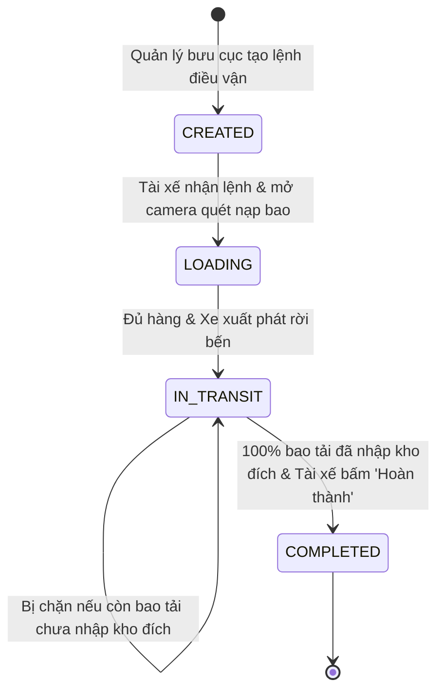
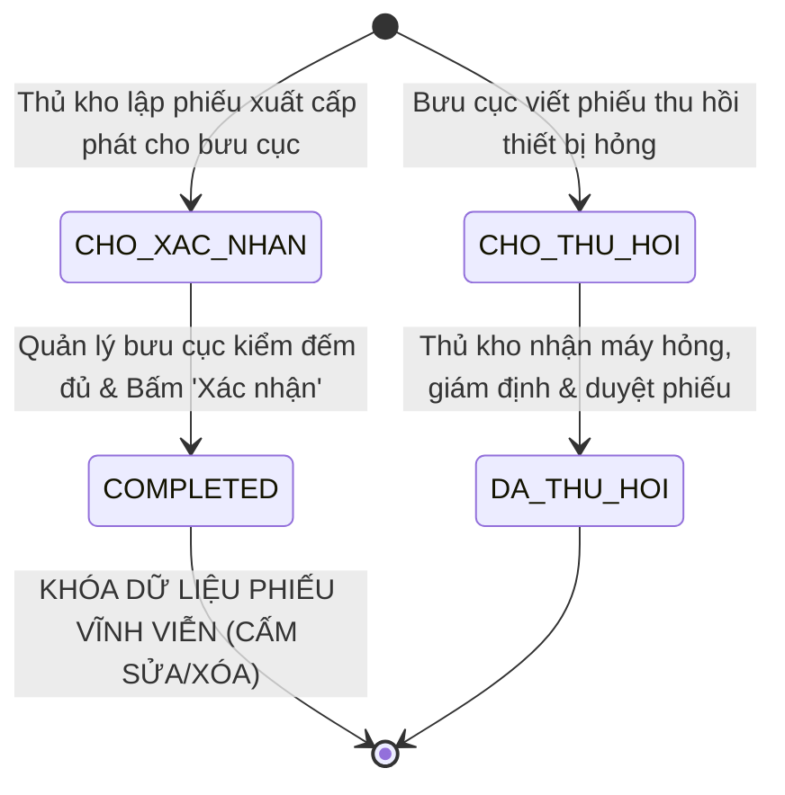

# 07. SƠ ĐỒ THỰC THỂ CSDL (ERD) & MÁY TRẠNG THÁI TOÀN HỆ THỐNG
## HỆ THỐNG RIKKEI POST WMS LOGISTICS

---

## 📌 1. Sơ Đồ Thực Thể Cơ Sở Dữ Liệu Quan Hệ (Entity Relationship Diagram - ERD)

---

## 🔄 2. Sơ Đồ Máy Trạng Thái Toàn Hệ Thống (State Machines)

### 2.1. Vòng Đời Đơn Hàng (`ORDER_STATUS`)

### 2.2. Vòng Đời Bao Tải Master Bag (`BAG_STATUS`)

### 2.3. Vòng Đời Chuyến Xe Điều Vận (`DISPATCH_STATUS`)

### 2.4. Vòng Đời Phiếu Xuất Cấp Phát & Thu Hồi Vật Tư (`SUPPLY_TICKET_STATUS`)

