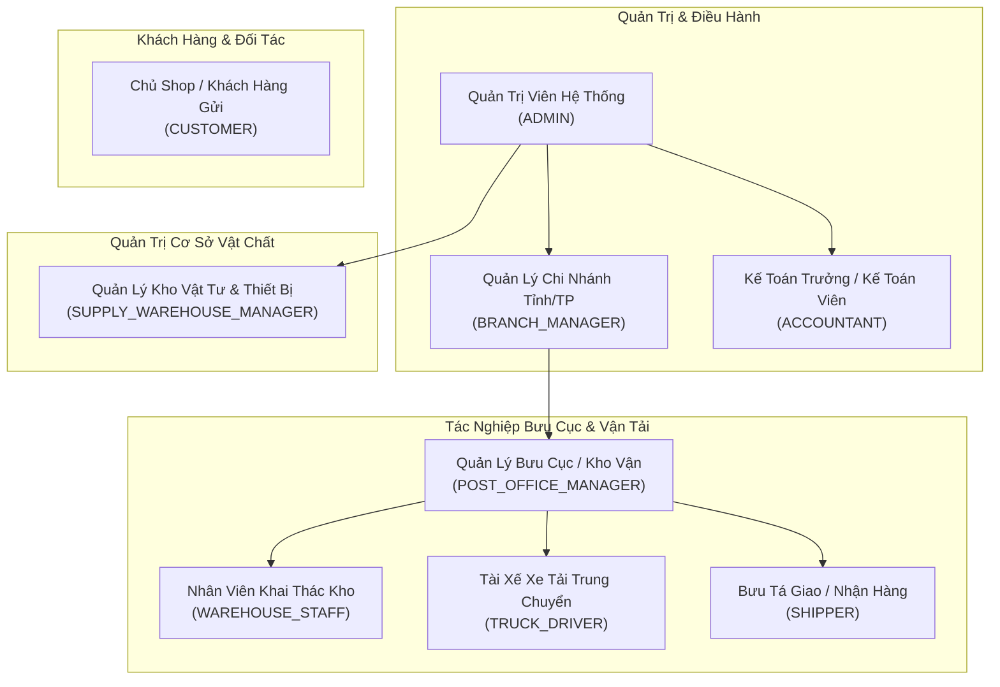

# HỆ THỐNG QUẢN LÝ BƯU CHÍNH & VẬN HÀNH KHO RIKKEI POST (WMS LOGISTICS)
## TÀI LIỆU SƠ ĐỒ LUỒNG NGHIỆP VỤ HỆ THỐNG (BUSINESS FLOW DIAGRAMS)

---

## 📌 1. Giới Thiệu Tổng Quan
**Rikkei Post WMS Logistics** là nền tảng quản trị chuỗi cung ứng chuyển phát thông minh thế hệ mới, đáp ứng đầy đủ nghiệp vụ giao vận bưu chính từ quy mô bưu cục vi mô đến các trung tâm chia chọn hàng đầu (Hub trung tâm). Hệ thống tích hợp sâu giữa phần mềm tác nghiệp Web/Mobile, phần cứng hiện trường (Camera quét Barcode 1D/2D, Máy in nhiệt A6, Cân điện tử, Seal kẹp chì an ninh) và công nghệ AI (Face-API chấm công sinh trắc học chống gian lận).

Thư mục `business_flows/` này tổng hợp toàn bộ các sơ đồ luồng nghiệp vụ thực tế, máy trạng thái dữ liệu (State Machine), ma trận phân quyền vai trò (RBAC) và quy chuẩn tác nghiệp chuẩn hóa cho đội ngũ kỹ sư phần mềm, quản lý vận hành và nhân sự nghiệp vụ.

---

## 🗺️ 2. Bản Đồ Danh Mục Tài Liệu Luồng Nghiệp Vụ

| STT | Tài Liệu Nghiệp Vụ | Nội Dung Trọng Tâm | Định Dạng Sơ Đồ |
|:---:|:---|:---|:---:|
| **01** | [01. Luồng Vận Hành Toàn Trình](file:///d:/My_Project/Logistics_research_project/business_flows/01_end_to_end_logistics_flow.md) | Vòng đời bưu gửi từ Shop tạo đơn → Bưu tá lấy hàng → Bưu cục nhận → Đóng bao & Kẹp chì → Điều vận xe tải → Trung chuyển Hub → Phân tuyến giao → Phát hàng & Thu hộ COD → Đối soát kế toán | Flowchart, Sequence Diagram |
| **02** | [02. Quy Trình Đóng Bao, Kẹp Chì & In Tem A6](file:///d:/My_Project/Logistics_research_project/business_flows/02_master_bag_and_seal_workflow.md) | Gom hàng lẻ thành Master Bag theo kho đích, thống kê kiện theo kho > 0, kẹp chì an ninh (Security Seal), in tem nhiệt A6 (Barcode 128 + QR), dỡ bao cắt chì | Flowchart, Workflow UI |
| **03** | [03. Lệnh Điều Vận & Cổng Tác Nghiệp Tài Xế Xe Tải](file:///d:/My_Project/Logistics_research_project/business_flows/03_dispatch_and_truck_driver_portal.md) | Phân quyền lập lệnh điều vận theo bưu cục, điều phối xe & tài xế kho trực thuộc, cổng tài xế quét Camera nạp bao lên xe, đồng bộ trạng thái vận chuyển và điều kiện hoàn thành | Swimlane, State Transition |
| **04** | [04. Chấm Công Khuôn Mặt FaceID & Chống Gian Lận](file:///d:/My_Project/Logistics_research_project/business_flows/04_faceid_attendance_verification.md) | Đăng ký vector khuôn mặt 128 chiều, chấm công camera trực tiếp, cơ chế xóa sạch ảnh cũ chống gian lận (Anti-spoofing Live Enforce), định vị GPS kho bưu cục, giao diện Mobile cuộn dọc | Sequence Diagram, Logic Flow |
| **05** | [05. Quản Lý Vật Tư, Thiết Bị & Thu Hồi Đồ Hỏng](file:///d:/My_Project/Logistics_research_project/business_flows/05_supply_and_equipment_recall.md) | Quản lý kho vật tư Google Maps & thủ kho, quy trình phiếu xuất cấp phát (`CHO_XAC_NHAN` → Bưu cục nhận đủ đồ → `COMPLETED` khóa sửa đổi), quy trình thu hồi thiết bị hỏng | Flowchart, State Machine |
| **06** | [06. Phân Tuyến Giao Nhận & Quản Lý Role Động](file:///d:/My_Project/Logistics_research_project/business_flows/06_route_and_role_management.md) | Phân định 2 loại tuyến (Xe máy giao hàng `MOTORBIKE_DELIVERY` vs Xe tải trung chuyển `TRUCK_TRANSFER`), phân quyền bưu cục quản lý tuyến, trang Admin quản trị Role động | Hierarchy Tree, Permissions |
| **07** | [07. Sơ Đồ Thực Thể CSDL & Máy Trạng Thái](file:///d:/My_Project/Logistics_research_project/business_flows/07_database_erd_and_state_machine.md) | ERD chi tiết các bảng CSDL (Orders, Bags, Dispatches, Supply, Users), Máy trạng thái (Order, Bag, Trip, Ticket Lifecycle) | ERD, State Machine |

---

## 🌐 3. Sơ Đồ Tương Tác Trực Quan HTML (Archify Interactive Standalone Viewers)
Hệ thống sử dụng bộ công cụ Archify để kết xuất các sơ đồ tương tác độc lập (Standalone Interactive HTML), cho phép người dùng mở trực tiếp trên trình duyệt web, khám phá các node, phóng to/thu nhỏ (zoom/pan), chuyển đổi Dark/Light mode, xem Semantic Passport và animation luồng dữ liệu thời gian thực:

1. 🏛️ **[Sơ Đồ Kiến Trúc Hệ Thống (System Architecture HTML)](file:///d:/My_Project/Logistics_research_project/business_flows/diagrams/rikkei_logistics_system.html)**:
   - Mô phỏng toàn bộ kiến trúc phân tầng: Shop Portal, Mobile PWA Bưu tá, Cổng tài xế quét Camera tem A6, Admin WMS Portal, AI Face-API, Spring Boot API Gateway, Order Service, Dispatch Service, Supply Service, Kafka Event Bus và PostgreSQL.
2. 🔄 **[Sơ Đồ Quy Trình Chuỗi Cung Ứng Toàn Trình (End-to-End Delivery Workflow HTML)](file:///d:/My_Project/Logistics_research_project/business_flows/diagrams/end_to_end_delivery.html)**:
   - Mô phỏng các làn tác nghiệp (Swimlanes): Chủ Shop, Bưu tá thu gom & phát hàng, Bưu cục gửi, Tài xế xe tải đường trục, Hub trung tâm, Bưu cục phát và Kế toán đối soát theo 4 giai đoạn logic.
3. 🗄️ **[Sơ Đồ Thực Thể Cơ Sở Dữ Liệu Tương Tác (Database Schema ERD HTML)](file:///d:/My_Project/Logistics_research_project/business_flows/diagrams/database_schema.html)**:
   - Thể hiện trực quan quan hệ giữa các bảng `users`, `warehouses`, `orders`, `master_bags`, `dispatch_orders` và `supply_tickets` với khóa chính, khóa ngoại và tỷ lệ quan hệ (Cardinality).

---

## 👥 4. Ma Trận Phân Quyền Vai Trò Hệ Thống (RBAC Matrix)

### Bảng Phân Quyền Tác Nghiệp Chi Tiết

| Chức Năng Tác Nghiệp | Admin | Quản Lý Chi Nhánh | Quản Lý Bưu Cục | Nhân Viên Khai Thác | Tài Xế Xe Tải | Bưu Tá Shipper | Quản Lý Kho Vật Tư | Kế Toán |
|:---|:---:|:---:|:---:|:---:|:---:|:---:|:---:|:---:|
| **Quản trị Người dùng & Phân quyền Role động** | ✅ Toàn quyền | 👁️ Xem khu vực | 👁️ Xem kho | ❌ | ❌ | ❌ | ❌ | ❌ |
| **Quản lý Đội xe tải (Thêm/Sửa thông tin xe)** | ✅ Toàn quyền | ✅ Khu vực mình | 👁️ Xem & gán tx | ❌ | ❌ | ❌ | ❌ | ❌ |
| **Tạo Lệnh Điều Vận Xe & Gom Bao** | ✅ | ✅ | ✅ Kho trực thuộc | ❌ | ❌ (Chỉ xem chuyến mình) | ❌ | ❌ | ❌ |
| **Cổng Tác Nghiệp Tài Xế (Quét camera nạp bao)** | ❌ | ❌ | ❌ | ❌ | ✅ Chỉ chuyến được gán | ❌ | ❌ | ❌ |
| **Đóng Bao Master Bag & Kẹp Chì** | ✅ | ✅ | ✅ | ✅ | ❌ | ❌ | ❌ | ❌ |
| **Quét Mã Lấy Hàng / Giao Hàng Bưu Tá** | ❌ | ❌ | ❌ | ❌ | ❌ | ✅ Mobile App | ❌ | ❌ |
| **Quản lý Kho Vật Tư, Phiếu Xuất/Nhập** | ✅ | 👁️ | ❌ | ❌ | ❌ | ❌ | ✅ Toàn quyền | 👁️ |
| **Bấm Xác Nhận Nhận Đủ Đồ Phiếu Xuất Kho** | ❌ | ❌ | ✅ Bưu cục đích | ❌ | ❌ | ❌ | ❌ | ❌ |
| **Viết Phiếu Thu Hồi Đồ Hỏng Về Kho Vật Tư** | ✅ | ✅ | ✅ Bưu cục mình | ❌ | ❌ | ❌ | ❌ | ❌ |
| **Quản Lý Tuyến Đường Xe Máy / Ô Tô** | ✅ Toàn quyền | ✅ Khu vực | ✅ Kho mình | ❌ | ❌ | ❌ | ❌ | ❌ |
| **Chấm Công Khuôn Mặt FaceID (Chống gian lận)** | 👁️ Báo cáo | 👁️ Báo cáo | 👁️ Duyệt ca | ✅ Tác nghiệp | ✅ Tác nghiệp | ✅ Tác nghiệp | ✅ Tác nghiệp | 👁️ Tính lương |

---

## 🛠️ 4. Công Nghệ & Công Cụ Tích Hợp
- **Bộ công cụ Archify**: Đã tích hợp sẵn tại [tools/archify](file:///d:/My_Project/Logistics_research_project/tools/archify) và Agent Skill `archify` phục vụ kết xuất sơ đồ trực quan tương tác (Interactive HTML Viewer, SVG Export).
- **Backend**: Spring Boot 3.x, JPA Hibernate, PostgreSQL, Kafka Event Streaming, SSE (Server-Sent Events) thông báo thời gian thực.
- **Frontend**: React 18, Vite, TypeScript, Tailwind CSS, Lucide Icons, Html5-Qrcode Barcode/QR Scanner, JsBarcode (Code-128), QRCodeSVG, Face-API.js.
